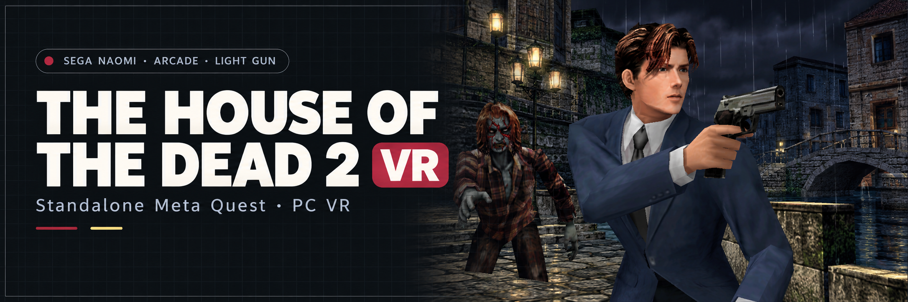

<div align="center">



# The House of the Dead 2 — Arcade VR
### Original SEGA NAOMI Light-Gun Action · Standalone Meta Quest & PC VR

[☕ Donate to VR4ALL](https://ko-fi.com/vr4all)

[](https://github.com/vr4all-standalone/hotd2-arcade-vr/releases/latest)
[](#quest-setup)
[](#your-game-files)

**[⬇️ Quest APK](https://github.com/vr4all-standalone/hotd2-arcade-vr/releases/latest/download/hotd2-arcade-vr-quest.apk)** · **[🖥️ PC VR ZIP](https://github.com/vr4all-standalone/hotd2-arcade-vr/releases/latest/download/hotd2-arcade-vr-pcvr.zip)** · **[🎮 Controls](#controls)**

[Checksums](https://github.com/vr4all-standalone/hotd2-arcade-vr/releases/latest/download/SHA256SUMS.txt) · [All releases](https://github.com/vr4all-standalone/hotd2-arcade-vr/releases)

**[🌐 VR4ALL — Standalone VR Mod Installer](https://github.com/vr4all-standalone/vr4all-standalone-vr-mod-installer)**

</div>

---

## Update v1.0.8

Validated automatic entry, full P1 red/P2 blue Arcade body and grip with grey details preserved, and a new gun-angle zero matching the old -10 degree pose. Legacy angles reset once; later adjustments persist. [Release notes](docs/releases/v1.0.8.md).

## Overview

Experimental standalone adaptation of [mikermak's HOTD2 VR engine](https://github.com/mikermak/hotd2-vr), using the shared menus and controls from Confidential Mission VR, Lupin VR and Death Crimson OX VR. This version boots the **NAOMI arcade `hotd2` cartridge**. Dreamcast discs are unsupported.

No game or BIOS is included. Supply your own files. Unofficial fan project, unaffiliated with Sega, Meta or the Flycast project. Physical headset testing remains pending. The [banner](hotd2-vr/assets/hotd2-arcade-banner.md) is AI-generated promotional artwork based on local arcade character, scene and pistol references; it is not a headset screenshot.

## What it does

- Rebuilds the arcade renderer's scenes in stereo, with a wider view and a separate stock aiming lens.
- Uses tracked guns, a laser, accepted-shot recoil and haptics, empty-magazine feedback and native reloads.
- Supports solo hand transfer and two players on one headset. P1 uses the left hand and P2 the right by default; the paused **Two players** setting reverses them.
- Hides guns, controllers and lasers during native story scenes, then restores them for interactive play.
- Prepares the arcade agent's own pistol from your game on first launch. You can skip preparation with B or Y. The Arcade gun, Zapper and custom GLB choices remain available.
- Saves gun choice, angle, reload mode, hand assignment, laser, haptics, world size, panel distance and wider-view settings.
- Checks actual cartridge and BIOS lengths and CRCs before loading. The tracked aiming correction changes live RAM; it leaves saved cabinet calibration unchanged.

## Your game files

Use the complete **USA MAME `hotd2` set**:

| File | Requirement |
| :--- | :--- |
| `hotd2.zip` | `epr-21585.ic22`, 2 MiB, CRC `b23d1a0c`, plus all twenty 8 MiB MPR ROMs. Keep the ZIP packed and lowercase. |
| `hod2bios.zip` | HOTD2's special BIOS: a verified 2 MiB `epr-21331.ic27`, `epr-21330.ic27` or `epr-21329.ic27`. A supported BIOS may instead be embedded in `hotd2.zip`. |

No CHD, PIC, track folder or Dreamcast image is needed. An ordinary NAOMI BIOS does not replace HOTD2's special BIOS. Other arcade revisions (`hotd2o`, `hotd2e`, `hotd2p`) have not been adapted; renaming their ZIPs does not convert them.

## Quest setup

1. Enable Developer Mode, connect your Quest by USB and allow USB debugging.
2. Install the local `hotd2-arcade-vr-quest.apk` with ADB or SideQuest:

   ```text
   adb install -r hotd2-arcade-vr-quest.apk
   adb shell appops set com.vrlightgunhub.hotd2arcade MANAGE_EXTERNAL_STORAGE allow
   ```

3. Put your files here:

   ```text
   /sdcard/Download/hotd2.zip
   /sdcard/Download/hod2bios.zip
   ```

4. Open **HOTD2 Arcade VR** in your app library. Its start screen identifies missing or invalid files and enables Play when the checks pass. First launch prepares the native pistol; subsequent starts reuse its validated cache.

The application ID is `com.vrlightgunhub.hotd2arcade`, separate from the upstream HOTD2 app and the other standalone ports. Quest 2, Pro, 3 and 3S are declared in the manifest; that declaration is not a hardware-performance certification.

## PC VR setup

Extract `hotd2-arcade-vr-pcvr.zip` into its own folder. Place your files in `roms/hotd2.zip` and `roms/hod2bios.zip`, select your OpenXR runtime and run **Play HOTD2 Arcade.cmd**. The portable package keeps its own configuration and generated pistol cache beside that copy of the executable.

## Controls

| Action | Quest Touch |
| :--- | :--- |
| Shoot | Trigger. In solo play a fresh trigger on the other hand transfers the gun. |
| Start / join | Solo: right A starts P1; left X joins P2. Joining applies **Two players**: P1 left / P2 right by default, or the reverse. With two players in, each hand's Start belongs to its assigned player. |
| Reload | B or Y; or shoot off-screen. **Reload → Point off-screen** removes the trigger requirement. |
| Settings / pause | Left Menu |
| Recenter | Left thumbstick click |
| Laser | Right thumbstick click |
| World size / gun size | Grip + thumbstick up/down or left/right |

**Blood color:** open Settings with the left Menu button and choose **Blood color: Red** or **Green**. The choice is saved immediately and takes effect the next time you start the game; a pending change says **(next start)**. This uses the arcade game's own blood-effect resources. Loading an old save state can restore its old effects; start without a save state to apply the new color.

A held Start stays with its original player until release, including through joining, leaving and changing **Two players**. The setting changes the two-player layout only; solo Start roles and either-trigger gun transfer stay the same. When joining is unavailable, X does not start P1.

The standalone free-play option supplies cabinet credits automatically. Settings pause emulation. Holding a trigger through a hand swap does not fire a new round when the menu closes.

## Build and validation

Windows requires Visual Studio 2022 C++ tools. Quest requires JDK 17, Android SDK 36.1, NDK `29.0.14206865` and CMake 3.22.1. Set `JAVA_HOME` and `ANDROID_HOME` for your installation.

```text
hotd2-vr\build-win.cmd Release ON
hotd2-vr\build-quest.cmd
hotd2-vr\re\hotd2_arcade_policy_test.cmd
hotd2-vr\re\hotd2_arcade_native_test.cmd
shell\android-studio\gradlew.bat -p shell\android-studio :flycast:test
```

Use `hotd2-vr/package-release.ps1` to create and check both artifacts from a clean committed tree. A release signing key lives outside the repository. The script checks application identity, matching source commit, native standalone restrictions, licensing, optional model credits and package contents.

See [the validation notes](hotd2-vr/notes/hotd2-arcade-validation.md) for tested scope and [the headset checklist](hotd2-vr/notes/hotd2-arcade-headset-checklist.md) for remaining hardware checks. Simulator checks cannot establish physical tracking, comfort, sustained headset frame rate or full-game compatibility. Later chapters and endings remain unverified.

## Credits and licence

Built on [Flycast](https://github.com/flyinghead/flycast), [mikermak's HOTD2 VR](https://github.com/mikermak/hotd2-vr), and the [Confidential Mission](https://github.com/vr4all-standalone/confidential-mission-vr), [Lupin](https://github.com/vr4all-standalone/lupin-the-third-vr) and [Death Crimson OX](https://github.com/vr4all-standalone/death-crimson-ox-vr) adaptations. Their authors' notices and Git history are retained.

The program is distributed under GPL-3.0 as described by the packaged `LICENSE.txt`, including cgltf's MIT notice and the compatible CC BY 4.0 Namco gun attribution. Optional bundled models have their own licences in `CREDITS.txt`. The native game pistol is generated from the player's game and is never included in the app, source or release archive.

### Player assignment regression

Run `powershell -NoProfile -File hotd2-vr/player-assignment-test.ps1` on a Windows development machine with Visual Studio C++ tools. It compiles the production hand policy, Start ownership, join/leave and menu code and checks both layouts against Confidential Mission behavior.

## Quest Start and Service buttons

Play launches immersive VR from passthrough or a virtual Quest Home. After loading,
**A** starts P1; **X** requests P2 where supported, after P1 has started. The second
gun appears only after native P2 acceptance. Two-player Starts follow the saved hand
assignment. Survivor retains its native single-player controls.

To enter Service, open the in-game VR menu and choose **Open Service Menu**, directly
above **Quit**. Holding A does not open Service. Normal controller buttons do not
enter the arcade menu; the row is available after initial loading, offline with VR guns enabled.

Inside standard NAOMI Service, **X = Next** and **tap A = Select**. The purple guide appears below
the native menu. Choose the native **EXIT** option to restart the game and restore
normal controls automatically; there is no B step. Leaving a submenu keeps Service
navigation available. Aiming, triggers and directions remain usable for native tests.

Held A/X inputs require release after opening, settings or focus recovery. Native
main-game boot and new game/session resets clear Service controls. Existing external
keyboard/gamepad cabinet controls remain available.

Ninja Assault and Survivor use Namco's native operator menu: **X = Down**,
**A = Enter**, with the stick also available for Up/Down. While it is open,
the same VR menu row reads **Exit Service Menu** and sends the native return
command after resuming. The guide and ordinary gameplay controls restore
automatically after the game leaves its operator menu. A alone never opens or
closes Service during ordinary gameplay.
